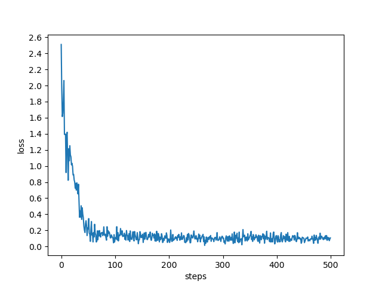

# The Loss in AI Translation

**Code for my 2024 paper comparing an LSTM sequence-to-sequence model and a Transformer, both written from scratch in PyTorch, on Hindi to English translation, with a close look at what gets lost when Jain scripture is translated by machine.**

[](LICENSE)

**Links:** [Paper](https://doi.org/10.58445/rars.1453) · [Transformer notebook](Transformer%20Model.ipynb) · [LSTM notebook](Seq2Seq2.ipynb) · [Arham Doshi](https://arhamdoshi.dev) · [LinkedIn](https://linkedin.com/in/arhamdoshi)

Arham Doshi, "The Loss in AI Translation: Analyzing LSTM and Transformer Models for Jain Scripture Translation," Research Archive of Rising Scholars, 2024. [doi:10.58445/rars.1453](https://doi.org/10.58445/rars.1453)



## Results

Every number below is in the saved outputs of the notebooks in this repo.

| Claim | Measured | Where |
|---|---|---|
| Both models were trained on real parallel text | 25,000 Hindi and English sentence pairs, split 22,500 for training and 2,500 for testing | `Transformer Model.ipynb`, cell 6 |
| The Transformer learned the training set | Training loss fell from 5.72 after the first epoch to 0.119 by epoch 43 | `Transformer Model.ipynb`, cell 29 |
| Low loss did not mean good translation | Sample translations stayed broken while the loss fell, the sign of overfitting a small corpus | Same cell, printed examples |
| The LSTM model can get short phrases right | Sentence-level BLEU of 0.81 on a short phrase, and 0 on fragments, in a random sample | `Seq2Seq2.ipynb`, cell 21 |

The main finding of the paper is qualitative: on Jain terms like *ahimsa*, *anekantavada*, *maitri*, and *Jina*, the errors fall into semantic distortion, loss of context, cultural misinterpretation, and plain linguistic mistakes. A score like BLEU cannot see most of them.

## Why it matters

Machine translation is usually judged by overlap with a reference sentence. For religious and philosophical text that misses the point: a translation can share most of its words with the reference and still turn a precise concept into a vague or wrong one. Hindi to English is also lower resource than the language pairs most models are tuned on. This project measures that gap directly, on text where the meaning matters more than the wording.

## How it works

1. **Data.** A Hindi and English parallel corpus, normalized for Devanagari Unicode and split 90/10.
2. **LSTM baseline.** An encoder-decoder RNN with attention, teacher forcing, and beam search, adapted from [a Kaggle notebook](https://www.kaggle.com/code/pashupatigupta/seq2seq-machine-translation-with-attention), with GRU and LSTM variants.
3. **Transformer from scratch.** Custom multi-head self-attention, feed-forward blocks, layer norm, and an encoder-decoder stack (d_model 512, 8 heads), with BPEmb byte-pair subword embeddings for both languages. Trained with Adam, cross-entropy loss, and mixed precision.
4. **Analysis.** Training loss curves, sentence BLEU, and a hand-built error taxonomy on Jain terms.

| Choice | Why |
|---|---|
| Write the Transformer by hand instead of using a library model | To understand every part of attention, not just call it |
| Subword (BPE) embeddings | Hindi is morphologically rich, and whole-word vocabularies miss too many forms |
| A qualitative error taxonomy next to BLEU | BLEU rewards word overlap, which is not what goes wrong with scripture |

## Tech stack

Python, PyTorch, Jupyter, BPEmb, NumPy, pandas, scikit-learn, NLTK (BLEU), Matplotlib.

## Getting started

```bash
git clone https://github.com/hammy229/Loss-in-AI-Translation---Ind-Research
cd Loss-in-AI-Translation---Ind-Research
pip install torch bpemb numpy pandas scikit-learn nltk matplotlib tqdm prettytable torchsummary jupyter
jupyter notebook
```

The notebooks read the corpus from `hindi_english_parallel.csv`. The file is not in this repo, so set the path in the first cells to your own copy of a Hindi and English parallel corpus. A GPU makes the Transformer practical to train.

## Project structure

```
Transformer Model.ipynb   the Transformer written from scratch, training, and sample translations
Seq2Seq2.ipynb            the LSTM and GRU encoder-decoder with attention, training, and BLEU
loss.png                  training loss over time
words_hn.xls              a Hindi and English word list (CSV despite the extension)
```

## Testing

This is a research notebook repo, so there are no automated tests. The notebooks keep their saved outputs, so every result above can be checked without rerunning anything.

## Limitations and next steps

- The Transformer overfit: training loss fell to 0.119 while sample translations stayed poor. A larger corpus, regularization, and a held-out validation curve are the next steps.
- BLEU was computed on individual sampled sentences, not on the whole test set, so there is no single corpus-level score to compare the models.
- The corpus file and trained weights are not included, and the notebooks use Windows file paths from the original machine.
- This was independent high school research, done in summer 2024.

## License

MIT, see [LICENSE](LICENSE). Built by [Arham Doshi](https://arhamdoshi.dev).
